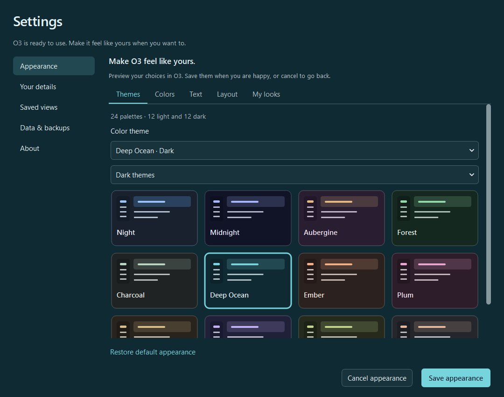

# O3 — Alpha 3 upgrade review 2

O3 should make everyday work understandable immediately. This Candidate 6 upgrade puts **Unanswered**, **Waiting for replies**, and **All mail** directly in Mail; adds clear customization with previews and Undo; and improves navigation, accessibility, and the Connections map while retaining O3's visual direction.



This is application development build **3.0.0-alpha3.upgrade2-dev**, ready for review with fictional sample information. It adds a complete Appearance editor and a working welcome screen in the review launcher. Native launcher integration and the approved runtime/runner are still pending. It is not a replacement installer.

## Try the review

Download the [latest review ZIP](review/appearance-review/O3_Alpha_3_Upgrade_Review_2.zip) and extract it, or use this checkout. [READ_ME_FIRST.txt](READ_ME_FIRST.txt) explains the available journeys and limitations. The sample workspace is created inside the review directory; the installed O3 workspace is not selected automatically.

The verified environment was Windows, Python 3.12.10, PySide6/Qt 6.9.2, RDFLib 7.6.0, and pyparsing 3.3.3. With Python 3.12 installed, run these commands in PowerShell from this checkout:

```powershell
py -3.12 -m venv .venv
.\.venv\Scripts\python.exe -m pip install -r requirements-review.txt
.\.venv\Scripts\python.exe -I -B review_app.py --example
```

`Open O3 Review.cmd` is a convenience launcher for the existing Python installation at `%LOCALAPPDATA%\Programs\Python\Python312`. For a virtual environment or another interpreter, use the command above instead. The ZIP contains the already verified application payload; dependency setup instructions are in this repository.

## What changed

- Mail opens with useful task views. Results explain when saved mail is incomplete; explicit email identity, reply ancestry, and mailbox boundaries determine the result. “No reply needed” and “Stop waiting” are reversible local choices.
- Personalize previews results before saving. Saved views support reopening, renaming, removal, and understandable choices without exposing internal rules by default.
- People, Documents, Calendar, and Projects remain ready to use. Project changes refresh related information already saved in O3, with a visible Retry action if that work fails.
- Connections keeps the starting item and its neighbors visible and provides map/list navigation, keyboard controls, and Center.
- Appearance has 24 distinct palettes, evenly divided between light and dark, with a visual gallery, custom accent colors, and stronger contrast. Text colors and primary buttons are checked for readability across each palette.
- Five text sizes and three lettering styles work alongside independent reading font, reading size, line spacing, and page width. Compact, balanced, or roomy spacing and a quiet layout make the workspace adjustable without changing its information.
- My looks saves, reuses, updates, renames, and removes favorite combinations. Preview, Save, Cancel, retry after a failed save, and Restore defaults cover the whole appearance and saved-look library. Unrelated preference saves cannot commit a preview.
- Settings switches to a section menu in narrow windows and at larger text sizes.
- The review launcher displays a theme-aware welcome screen and the O3 icon, handing off on actual workspace readiness or failure. The welcome screen can be previewed or disabled. Native executable resource integration remains pending.
- The seven recorded QC defects were addressed: persistent failure notices, toolbar crowding, compact activation, project refresh, first-use clutter, full titles, and date clipping.

## Verification

The [appearance verification record](review/appearance-review/VERIFICATION.json) records the final application and visual suites, 181 native appearance checks, and 51 rerun native regression checks. Those include 24-palette contrast coverage, extreme accent choices, large text, narrow Settings, keyboard selection, failed-save retry, saved looks, reader selection preservation, reopening, and the welcome-screen handoff.

Open [APPEARANCE_REVIEW.html](review/appearance-review/APPEARANCE_REVIEW.html) locally for the illustrated report. Browse the [12 light palettes](review/appearance-review/images/palettes-light.png), [12 dark palettes](review/appearance-review/images/palettes-dark.png), [Settings](review/appearance-review/images/appearance-light.png), and [welcome screen](review/appearance-review/images/welcome-dark.png). The [previous review](review/upgrade-review/UPGRADE_REVIEW.html) and its ZIP remain preserved.

From the checkout root, use the same configured Python interpreter to run the application suite and visual component suite:

```powershell
.\.venv\Scripts\python.exe -I -B -c "import sys,unittest;sys.path.insert(0,'O3/O3_PRODUCT/APP');r=unittest.TextTestRunner(verbosity=1).run(unittest.defaultTestLoader.discover('O3/O3_PRODUCT/APP/tests'));sys.exit(not r.wasSuccessful())"
.\.venv\Scripts\python.exe -I -B tests/test_visual_upgrade.py
```

The immutable Candidate 6 package integrity test skips when that original local evidence package is absent. It passed in the original verification environment. Other tests use isolated synthetic state. Native QC scripts in `verification/` require a fresh output directory; passing `--platform windows` to `qc_upgrade.py` opens application windows for visual checks.

The latest ZIP's SHA-256 and payload count are in the [verification record](review/appearance-review/VERIFICATION.json). `BUILD_REVIEW_MANIFEST.json` records every payload file and hash.

`build_review.py` rebuilds the review ZIP and manifest. Its timestamp changes on rebuilding; the checked-in ZIP and manifest preserve the reviewed artifact.

## Baseline and remaining integration

The source baseline is **Alpha 3 Candidate 6**, revision `026a43087fdbe63c835a94bfb40efb5d867c962f`. The original Candidate 6 ZIP SHA-256 is `3f47c9e78577463f83554bc0d4b0141c5800add54db3662cf0b6f0baf40e82c4`. Reviewed application changes were checkpointed locally at `18af367` before this publication. The existing `review/O3_Review_Handoff.zip` and GitHub history are preserved.

The application source lives in `O3/O3_PRODUCT/APP`; `AI_RUNTIME/seed.py` and `synthetic_examples.json` supply fictional review data. These helpers and the earlier AI Runtime Verification ZIP are not the approved runtime/runner package.

Remaining work depends on the authoritative native launcher source and actual approved runtime/runner. The sole managed native startup splash must be integrated and qualified there; [the startup contract](O3/O3_PRODUCT/APP/o3_gui/assets/NATIVE_STARTUP_CONTRACT.txt) documents the boundary. The separate review entry point has one working welcome screen and does not start or modify the inherited executable. It imposes no minimum delay and does not simulate progress percentages.

O3 currently reads supported prepared source exports. This upgrade does not add a live Outlook/Gmail connection or arbitrary-format import. “Draft a reply” creates a local draft; it does not send mail. Verification used synthetic information, keyboard/UIA smoke checks, and measured layouts; full assistive-technology and production-data qualification remain separate work.
